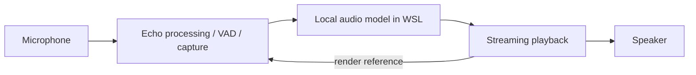

# Turnwave

[](https://github.com/Arudchayan/Turnwave/actions/workflows/tests.yml)

An experimental local speech-to-speech assistant for Windows and WSL2, built
around **LiquidAI LFM2.5-Audio-1.5B** and its native Liquid audio runner.

The app listens while the model replies and can cancel playback when you speak.
It adds interruption handling around a turn-based audio model. This is a research
prototype: natural pauses, speaker echo and response quality remain limitations.

[Architecture](docs/ARCHITECTURE.md) · [Results and lessons](docs/RESULTS.md) ·
[Example audio](research/examples/README.md) ·
[Reproduce checks and figures](docs/EVALUATION.md) · [Known limits](docs/KNOWN_LIMITATIONS.md)



## What we tested

| Work | Finding | Status |
| --- | --- | --- |
| Final-block playback race | Forced regression: 0/2,003 → 2,003/2,003 samples played | Fixed and regression-tested |
| Semantic completion screen | Faster completion gains also released four unfinished prefixes | Rejected |
| Selective opening capture | Six paired cases produced identical captured bytes | Not adopted |
| Native content baseline | 24 actual generated answers, including six length-limited failures | Small diagnostic slice |
| Example model replies | One text-rubric pass and one ownership failure, with separate ASR | Saved WAVs and transcripts |

See [results](docs/RESULTS.md) for methods, per-case data and limitations.

## Prerequisites

- Windows with working input/output devices and WSL2 Ubuntu.
- Python 3.12 for the application. Node.js for browser-script tests.
- A compatible Liquid audio native runner and separately obtained model files.
- Suitable hardware for the selected runner; performance depends on hardware.

The native integration pins llama.cpp PR #18641 commit
`ec9d1fdd9cc18643c5e161b65b8053f6f6f34a4b`. Obtain the source checkout,
model assets and toolchains separately; review [their terms](docs/THIRD_PARTY.md).
For an optional CUDA build, activate CMake, compatible CUDA 13 `nvcc` and a host
C++ compiler in WSL, then run from the repository root:

```bash
bash src/build_cuda_server.sh
```

The helper expects an existing checkout at `~/liquid-build`, verifies the exact
revision and accepts clean source or the complete reviewed patch set. It does
not clone, fetch, reset or install prerequisites. WSL environment overrides are
`LOCALVOICE_RUNNER_SOURCE`, `LOCALVOICE_RUNNER_BUILD_DIR`,
`LOCALVOICE_BUILD_JOBS` and `CUDACXX`. The build contract has fake-command tests;
a clean-machine native build has not been validated for this release.

## Setup and run

```powershell
python -m venv .venv
.venv/Scripts/Activate.ps1
python -m pip install -r requirements.txt
```

Place model files in `models/LFM2.5-Audio-1.5B-GGUF/`:

- `LFM2.5-Audio-1.5B-Q8_0.gguf` or `LFM2.5-Audio-1.5B-Q4_0.gguf`
- `mmproj-LFM2.5-Audio-1.5B-Q4_0.gguf`
- `vocoder-LFM2.5-Audio-1.5B-Q4_0.gguf`
- `tokenizer-LFM2.5-Audio-1.5B-Q4_0.gguf`

The launcher prefers a local runner under `~/liquid-build/build/bin` inside
WSL. `LOCALVOICE_GPU_RUNNER` can select another runner directory; a prebuilt
runner may instead be placed under `models/runner/llama-liquid-audio-ubuntu-x64`.
Keep the required shared libraries with the runner. Stop the server before
applying the complete five-patch set using `src/apply_runner_fixes.sh`; that
helper patches the same existing checkout and rebuilds the server.

From the repository root, start the backend:

```powershell
wsl -d Ubuntu bash src/server_wsl.sh
```

After it prints `Server ready`, use a second terminal:

```powershell
$env:LOCALVOICE_START_MUTED = "1"
python src/app.py
```

Open **http://127.0.0.1:8000**, select the input device and unmute when ready.
Headphones are the more predictable starting setup. Muted startup still opens
an input stream but does not submit microphone turns.

`LOCALVOICE_SERVER` changes the backend URL (default local port 8080).
`LOCALVOICE_CHAT_SYSTEM` changes the chat instruction. Optional transcription
uses `LOCALVOICE_ASR_SERVER` and requires a genuinely separate model context.
The app and backend test entry points reserve exclusive context ownership;
stop the app before running tests that use its backend, even while muted.

## Tests

```powershell
python -m pip install -r requirements-dev.txt
python -m pytest tests -q
python scripts/check_publication.py
```

The unit/integration suite uses generated fixtures and simulated devices.
No model weights, private recordings or live audio devices are required.
Node.js enables browser-script checks, which otherwise skip explicitly.
Optional CPU recognizer evaluations use `requirements-eval.txt` and separately
obtained local weights. Exploratory tools under `src/synth/` have additional
prerequisites; they are not the default test suite.


## Research and reproducibility

[The research index](research/README.md) connects measured observations, charts,
decisions and examples. [Evaluation](docs/EVALUATION.md) explains how to run the
offline tests, regenerate charts and prepare content-benchmark inputs. Published
data reproduce reported counts and figures; exact historical neural reruns also
require assets and source inputs that are not all distributed here. The 24-case
content slice is not a full VoiceBench score or a leaderboard claim.

## Recording and privacy

Normal launches write private diagnostics under `outputs/logs/`. Audio archiving
is opt-in; see [data handling](docs/PRIVACY.md) and [recorded sessions](docs/RECORDED_SESSIONS.md).
Muted startup opens the input device but does not submit microphone turns.
Keep these loopback services local; they have no multi-user authentication.

The repository includes two synthetic reply examples. Session recordings and
raw experiment data are kept locally; see [data handling](docs/PRIVACY.md) for
storage details and [sharing results](docs/PUBLICATION.md) before contributing media.

## Repository map

- `src/`: application, audio pipeline and native runner helpers.
- `src/synth/`: optional evaluation and research tools with additional prerequisites.
- `tests/`: generated-fixture and simulated-device regressions.
- `patches/`: reviewed changes against the pinned external runner.
- `docs/`, `research/`: architecture, evidence, limitations and curated examples.

## License

Turnwave's application code and documentation are [MIT licensed](LICENSE).
Models and dependencies have their own [licenses](docs/THIRD_PARTY.md).

See [contributing](CONTRIBUTING.md), [security](SECURITY.md) and
[publication guidance](docs/PUBLICATION.md).
