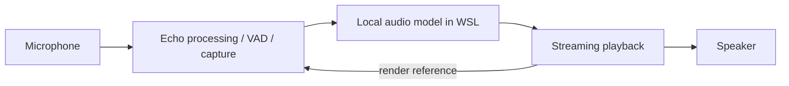

# Turnwave

[](https://github.com/Arudchayan/Turnwave/actions/workflows/tests.yml)

An experimental local speech-to-speech assistant for Windows and WSL2, built
around **LiquidAI LFM2.5-Audio-1.5B** and its native Liquid audio runner.

The app listens while the model replies and can cancel playback when you speak.
It adds interruption handling around a turn-based audio model. This is a research
prototype: natural pauses, speaker echo and response quality remain limitations.

[Architecture](docs/ARCHITECTURE.md) · [Results and lessons](docs/RESULTS.md) ·
[Example audio](research/examples/README.md) ·
[Reproduce checks and figures](docs/EVALUATION.md) · [Known limits](docs/KNOWN_LIMITATIONS.md)



## What we tested

| Work | Finding | Status |
| --- | --- | --- |
| Final-block playback race | Forced regression: 0/2,003 → 2,003/2,003 samples played | Fixed and regression-tested |
| Semantic completion screen | Faster completion gains also released four unfinished prefixes | Rejected |
| Selective opening capture | Six paired cases produced identical captured bytes | Not adopted |
| Native content baseline | 24 actual generated answers, including six length-limited failures | Small diagnostic slice |
| Example model replies | One text-rubric pass and one ownership failure, with separate ASR | Saved WAVs and transcripts |
| LFM3 inference optimization | `--flash-attn on --cache-type-k q8_0 --cache-type-v q8_0 -np 1`: speaker TTFT 0.596 s → 0.102 s at 3,451 MiB VRAM | Configured in `src/server_lfm3_wsl.sh` |
| Jarvis intermediary & tools | `get_time`, `get_weather`, `system_status`, `remember`/`recall`, `consult_expert`, `/api/prompt`, pipelined TTS | Integrated and tested |

See [results](docs/RESULTS.md) for methods, per-case data and limitations.

## Prerequisites

- Windows with working input/output devices and WSL2 Ubuntu.
- Python 3.12 for the application. Node.js for browser-script tests.
- A compatible Liquid audio native runner and separately obtained model files.
- Suitable hardware for the selected runner; performance depends on hardware.

The native integration pins llama.cpp PR #18641 commit
`ec9d1fdd9cc18643c5e161b65b8053f6f6f34a4b`. Obtain the source checkout,
model assets and toolchains separately; review [their terms](docs/THIRD_PARTY.md).
For an optional CUDA build, activate CMake, compatible CUDA 13 `nvcc` and a host
C++ compiler in WSL, then run from the repository root:

```bash
bash src/build_cuda_server.sh
```

The helper expects an existing checkout at `~/liquid-build`, verifies the exact
revision and accepts clean source or the complete reviewed patch set. It does
not clone, fetch, reset or install prerequisites. WSL environment overrides are
`LOCALVOICE_RUNNER_SOURCE`, `LOCALVOICE_RUNNER_BUILD_DIR`,
`LOCALVOICE_BUILD_JOBS` and `CUDACXX`. The build contract has fake-command tests;
a clean-machine native build has not been validated for this release.

## Setup and run

```powershell
python -m venv .venv
.venv/Scripts/Activate.ps1
python -m pip install -r requirements.txt
```

Place model files in `models/LFM2.5-Audio-1.5B-GGUF/`:

- `LFM2.5-Audio-1.5B-Q8_0.gguf` or `LFM2.5-Audio-1.5B-Q4_0.gguf`
- `mmproj-LFM2.5-Audio-1.5B-Q4_0.gguf`
- `vocoder-LFM2.5-Audio-1.5B-Q4_0.gguf`
- `tokenizer-LFM2.5-Audio-1.5B-Q4_0.gguf`

The launcher prefers a local runner under `~/liquid-build/build/bin` inside
WSL. `LOCALVOICE_GPU_RUNNER` can select another runner directory; a prebuilt
runner may instead be placed under `models/runner/llama-liquid-audio-ubuntu-x64`.
Keep the required shared libraries with the runner. Stop the server before
applying the complete five-patch set using `src/apply_runner_fixes.sh`; that
helper patches the same existing checkout and rebuilds the server.

### Optional LFM3 voice backend

LFM3-Omni-2B can also be used with a recent llama.cpp server. It uses a different
protocol, so it does not use the pinned LFM2.5 runner or its patches. Obtain the
Q4_K_M model and projector from [LiquidAI's GGUF release](https://huggingface.co/LiquidAI/LFM3-Omni-2B-GGUF)
into `models/LFM3-Omni-2B-GGUF/`, and a compatible llama.cpp build (b11960 or
newer) separately. The default launcher looks for the b12032 CUDA build in
`models/runner/llama-b12032-cuda/files/llama-b12032/`; set
`LOCALVOICE_LFM3_RUNNER` inside WSL to choose another build. CUDA builds also
need compatible runtime libraries. The launcher checks the matching b12032
CUDA 13.4 runtime under `models/runner/llama-b12032-cuda/runtime/`; alternatively
set `LOCALVOICE_CUDA_LIB` inside WSL to their directory. With those assets installed:

```powershell
wsl -d Ubuntu bash src/server_lfm3_wsl.sh
```

In a second terminal, set `$env:LOCALVOICE_BACKEND = 'lfm3'` before launching
`python src/app.py`. The default remains `lfm2`. LFM3 uses a realtime WebSocket
for speech conversation and transcription, and streaming PCM for synthesis.
The tested configuration and its limits are recorded in [results](docs/RESULTS.md).

To try an independently prepared LFM3 Omni research variant, stop the backend and
start it again in WSL with all three variables set:

```bash
LOCALVOICE_LFM3_VARIANT=research \
LOCALVOICE_LFM3_RESEARCH_MODEL=/path/to/research-model.gguf \
LOCALVOICE_LFM3_RESEARCH_PROJECTOR=/path/to/matching-projector.gguf \
bash src/server_lfm3_wsl.sh
```

Use a projector validated against that specific model. Restart the backend without
these variables to return to the standard model. This selects weights at server
startup; it is not a live toggle. The research files must be prepared separately:
Heretic compatibility with LFM3 Omni, export to GGUF, and speech quality have not
yet been verified. The existing GGUF alone does not establish that Heretic can
process this model. Model modifications may change behavior and quality.

The launch script `src/server_lfm3_wsl.sh` configures llama.cpp inference and acoustic sampling optimizations
tuned for 4 GiB GPU memory limits:
- FlashAttention (`--flash-attn on`)
- Symmetric 8-bit quantized KV caching (`--cache-type-k q8_0 --cache-type-v q8_0`)
- Single parallel sequence slot (`-np 1`)
- Natural RVQ acoustic sampling (`--temp 0.7 --top-k 40 --top-p 0.9 --min-p 0.05 --repeat-penalty 1.05`)

On an NVIDIA GeForce RTX 3050 Laptop GPU (4 GiB), this configuration keeps peak VRAM
at 3,451 MiB, reduces speaker-check time-to-first-audio (`last_ttft`) from 0.596 s
to 0.102 s, and avoids the flat pitch and metallic buzz caused by greedy (`--temp 0`) RVQ audio codec sampling. Environment overrides are
`LOCALVOICE_FLASH_ATTN`, `LOCALVOICE_KV_TYPE`, `LOCALVOICE_PARALLEL`, `LOCALVOICE_TEMP`, `LOCALVOICE_TOP_K`, `LOCALVOICE_TOP_P`, `LOCALVOICE_MIN_P`, and `LOCALVOICE_REPEAT_PENALTY`. Optional voice conditioning overrides on the client side are `LOCALVOICE_VOICE` and `LOCALVOICE_SPEAKER_REF`.

From the repository root, start the backend:

```powershell
wsl -d Ubuntu bash src/server_wsl.sh
```

After it prints `Server ready`, use a second terminal:

```powershell
$env:LOCALVOICE_START_MUTED = "1"
python src/app.py
```

Open **http://127.0.0.1:8000**, select the input device and unmute when ready.
Headphones are the more predictable starting setup. Muted startup still opens
an input stream but does not submit microphone turns.
The “Pause before reply” control trades response speed for more time to pause
while speaking. Changes apply between utterances; longer waits cannot guarantee
that an unfinished sentence will remain together. The setting returns to the
default when the app restarts.

`LOCALVOICE_SERVER` changes the backend URL (default local port 8080).
`LOCALVOICE_CHAT_SYSTEM` changes the chat instruction. Optional transcription
uses `LOCALVOICE_ASR_SERVER` and requires a genuinely separate model context.
The app and backend test entry points reserve exclusive context ownership;
stop the app before running tests that use its backend, even while muted.

### Optional cloud conversation and web search

By default Turnwave uses the local speech-to-speech model. To use an OpenCode Zen
chat-completions model instead, configure these environment variables before
starting `src/app.py`:

```powershell
$env:LOCALVOICE_AGENT = 'opencode-zen'
$env:LOCALVOICE_AGENT_MODEL = 'kimi-k3' # optional; choose a compatible chat-completions model
```

Set `OPENCODE_ZEN_API_KEY` in the application process environment using your
preferred secret manager. Set `BRAVE_SEARCH_API_KEY` there as well to enable
Brave search, or set `LOCALVOICE_SEARCH=ddg` to enable DuckDuckGo HTML search
without a search API key. Avoid saving any key in a script or committing it to
the repository.

The local voice server still performs transcription and speech synthesis. The
recognized text and recent conversation are sent to OpenCode Zen; if configured,
search queries go to the configured search provider (Brave or DuckDuckGo) and
search results go to the model. The interface shows the active mode, model,
search availability, and links returned by search. Without a search key or
`LOCALVOICE_SEARCH=ddg`, conversation works but web search is unavailable. The
model may choose whether to search. `LOCALVOICE_AGENT=opencode-go` selects Go
and uses `OPENCODE_GO_API_KEY`. OpenCode describes Go as intended for
coding-agent traffic, so general conversation may not be supported; choose Zen
for general conversation. See [OpenCode Go model endpoints](https://opencode.ai/v2/docs/console/go/)
and [Brave Search](https://api-dashboard.search.brave.com/app/documentation/web-search/get-started).
Keep keys in your process environment, never in tracked files. The cloud path
requires network access and provider accounts; it is not covered by the local
model's privacy guarantees. The interface reports missing configuration and
request failures. Agent context is kept in memory and reset with the conversation.

### Jarvis voice intermediary and local capabilities

When an external agent backend is active (`LOCALVOICE_AGENT=opencode-go`, `opencode-zen`, or `custom` via `LOCALVOICE_CUSTOM_ENDPOINT`, defaulting to `http://127.0.0.1:8081/v1/chat/completions`),
Turnwave operates as a voice intermediary ("Jarvis" persona) bridging the user with
local tools, expert reasoning delegation, and search:

- **Built-in local tools**:
  - `get_time`: Queries remote IANA timezones (local clock, date, and weekday are pre-injected in the system prompt for zero-round-trip answers).
  - `get_weather`: Live conditions and forecasts via Open-Meteo.
  - `system_status`: Queries GPU model, VRAM utilization, temperature, and disk space via `nvidia-smi` and system utilities (with a 10-second cached snapshot injected into the system prompt).
  - `remember` / `recall`: Retains session and persistent user preferences or facts across turns.
- **Expert delegation (`consult_expert`)**: For complex programming, mathematical, or architectural questions, the intermediary delegates to a deep reasoning model (e.g. `kimi-k3`). The full structured technical brief is rendered in the web studio's Expert Notes cards, while the assistant speaks a concise 2–3 sentence takeaway.
- **Persona switching (`set_persona`)**: Dynamically switches voice style between `jarvis` (composed intermediary), `direct` (zero-fluff operator), `natural`, `concise`, and `storyteller`.
- **Hybrid text prompt (`/api/prompt`)**: Endpoint (`POST /api/prompt`) allowing users to type prompts directly from the studio interface while receiving spoken voice output and preserving conversation history.
- **Sentence-pipelined TTS**: Multi-sentence replies (>110 characters) are chunked into sentence segments (first sentence capped at 120 characters, subsequent segments ~220 characters) and pipelined sequentially to the TTS runner, delivering initial spoken audio in 50–90 ms without waiting for the complete multi-sentence paragraph to synthesize.

## Tests

```powershell
python -m pip install -r requirements-dev.txt
python -m pytest tests -q
python scripts/check_publication.py
```

The unit/integration suite uses generated fixtures and simulated devices.
No model weights, private recordings or live audio devices are required.
Node.js enables browser-script checks, which otherwise skip explicitly.
Optional CPU recognizer evaluations use `requirements-eval.txt` and separately
obtained local weights. Exploratory tools under `src/synth/` have additional
prerequisites; they are not the default test suite.


## Research and reproducibility

[The research index](research/README.md) connects measured observations, charts,
decisions and examples. [Evaluation](docs/EVALUATION.md) explains how to run the
offline tests, regenerate charts and prepare content-benchmark inputs. Published
data reproduce reported counts and figures; exact historical neural reruns also
require assets and source inputs that are not all distributed here. The 24-case
content slice is not a full VoiceBench score or a leaderboard claim.

## Recording and privacy

Normal launches write private diagnostics under `outputs/logs/`. Audio archiving
is opt-in; see [data handling](docs/PRIVACY.md) and [recorded sessions](docs/RECORDED_SESSIONS.md).
Muted startup opens the input device but does not submit microphone turns.
Keep these loopback services local; they have no multi-user authentication.

The repository includes two synthetic reply examples. Session recordings and
raw experiment data are kept locally; see [data handling](docs/PRIVACY.md) for
storage details and [sharing results](docs/PUBLICATION.md) before contributing media.

## Repository map

- `src/`: application, audio pipeline and native runner helpers.
- `src/synth/`: optional evaluation and research tools with additional prerequisites.
- `tests/`: generated-fixture and simulated-device regressions.
- `patches/`: reviewed changes against the pinned external runner.
- `docs/`, `research/`: architecture, evidence, limitations and curated examples.

## License

Turnwave's application code and documentation are [MIT licensed](LICENSE).
Models and dependencies have their own [licenses](docs/THIRD_PARTY.md).

See [contributing](CONTRIBUTING.md), [security](SECURITY.md) and
[publication guidance](docs/PUBLICATION.md).
