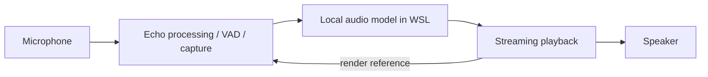

# Turnwave

[](https://github.com/Arudchayan/Turnwave/actions/workflows/tests.yml)

An experimental local speech-to-speech assistant for Windows and WSL2, built
around **LiquidAI LFM2.5-Audio-1.5B** and its native Liquid audio runner.

The app listens while the model replies and can cancel playback when you speak.
It adds interruption handling around a turn-based audio model. This is a research
prototype: natural pauses, speaker echo and response quality remain limitations.

[Architecture](docs/ARCHITECTURE.md) · [Results and lessons](docs/RESULTS.md) ·
[Example audio](research/examples/README.md) ·
[Reproduce checks and figures](docs/EVALUATION.md) · [Known limits](docs/KNOWN_LIMITATIONS.md)

[Change log](CHANGELOG.md) · [Experiment ledger](EXPERIMENTS.md)



## Optional cloud conversation and web search

Local voice remains the default. To use a cloud model, start the local voice
backend as described below, then set environment variables in the application terminal
before starting `python src/app.py`:

```powershell
$env:LOCALVOICE_AGENT = 'opencode-go' # or opencode-zen
$env:LOCALVOICE_AGENT_MODEL = 'kimi-k3' # choose a model available to your provider
$env:LOCALVOICE_SEARCH = 'ddg' # ddg, bing, brave, or none
```

Set `OPENCODE_GO_API_KEY` in the application environment (or
`OPENCODE_ZEN_API_KEY` for Zen) before starting it. Brave search also requires
`BRAVE_SEARCH_API_KEY`; without it Brave search is
unavailable. The Conversation and search settings panel can switch modes, models,
and search providers while the app is running. Changing the mode or model starts
a new conversation; credentials remain in the application environment.
Environment variables set startup defaults. Recognized speech and conversation history are sent to the
chosen provider; search queries are sent to the selected search service. The
local audio backend still handles transcription and speech synthesis. Check the
provider's current terms: OpenCode Go is intended for coding-agent traffic.
Search results can be incomplete, and provider limits can prevent responses.
The voice-to-search flow has automated simulated coverage but has not yet passed
a complete real-device spoken-search acceptance test.

If a cloud reply is interrupted after playback starts, the next turn can use
its generated text as context, explicitly marked as possibly unheard. Playback
does not provide word-level alignment, so the model cannot know which words the
listener actually heard. Interruptions before any audio is accepted retain only
the recognized request.

## Optional delayed echo protection

If the microphone picks up a delayed copy of the assistant's speech, set the
profile in PowerShell before starting the app:

```powershell
$env:LOCALVOICE_ECHO_PROFILE = 'long'
```

The standard profile remains the default. The longer profile reduced false starts in one synthetic
comparison, but delayed one quiet interruption; it is experimental and has not
been validated for a real headset or room. See [results](docs/RESULTS.md).

## What we tested

| Work | Finding | Status |
| --- | --- | --- |
| Final-block playback race | Forced regression: 0/2,003 → 2,003/2,003 samples played | Fixed and regression-tested |
| Semantic completion screen | Faster completion gains also released four unfinished prefixes | Rejected |
| Selective opening capture | Six paired cases produced identical captured bytes | Not adopted |
| Native content baseline | 24 actual generated answers, including six length-limited failures | Small diagnostic slice |
| Example model replies | One text-rubric pass and one ownership failure, with separate ASR | Saved WAVs and transcripts |

See [results](docs/RESULTS.md) for methods, per-case data and limitations.

## Prerequisites

- Windows with working input/output devices and WSL2 Ubuntu.
- Python 3.12 for the application. Node.js for browser-script tests.
- A compatible Liquid audio native runner and separately obtained model files.
- Suitable hardware for the selected runner; performance depends on hardware.

The native integration pins llama.cpp PR #18641 commit
`ec9d1fdd9cc18643c5e161b65b8053f6f6f34a4b`. Obtain the source checkout,
model assets and toolchains separately; review [their terms](docs/THIRD_PARTY.md).
For an optional CUDA build, activate CMake, compatible CUDA 13 `nvcc` and a host
C++ compiler in WSL, then run from the repository root:

```bash
bash src/build_cuda_server.sh
```

The helper expects an existing checkout at `~/liquid-build`, verifies the exact
revision and accepts clean source or the complete reviewed patch set. It does
not clone, fetch, reset or install prerequisites. WSL environment overrides are
`LOCALVOICE_RUNNER_SOURCE`, `LOCALVOICE_RUNNER_BUILD_DIR`,
`LOCALVOICE_BUILD_JOBS` and `CUDACXX`. The build contract has fake-command tests;
a clean-machine native build has not been validated for this release.

## Setup and run

```powershell
python -m venv .venv
.venv/Scripts/Activate.ps1
python -m pip install -r requirements.txt
```

Place model files in `models/LFM2.5-Audio-1.5B-GGUF/`:

- `LFM2.5-Audio-1.5B-Q8_0.gguf` or `LFM2.5-Audio-1.5B-Q4_0.gguf`
- `mmproj-LFM2.5-Audio-1.5B-Q4_0.gguf`
- `vocoder-LFM2.5-Audio-1.5B-Q4_0.gguf`
- `tokenizer-LFM2.5-Audio-1.5B-Q4_0.gguf`

The launcher prefers a local runner under `~/liquid-build/build/bin` inside
WSL. `LOCALVOICE_GPU_RUNNER` can select another runner directory; a prebuilt
runner may instead be placed under `models/runner/llama-liquid-audio-ubuntu-x64`.
Keep the required shared libraries with the runner. Stop the server before
applying the complete five-patch set using `src/apply_runner_fixes.sh`; that
helper patches the same existing checkout and rebuilds the server.

### Optional LFM3 Omni voice backend

LFM3-Omni-2B can run with a recent compatible llama.cpp server instead of the
pinned LFM2.5 runner. Obtain the Q4_K_M model and matching projector from the
[LiquidAI GGUF release](https://huggingface.co/LiquidAI/LFM3-Omni-2B-GGUF)
into `models/LFM3-Omni-2B-GGUF/`, and separately install a compatible
`llama-server`. The launcher defaults to the b12032 CUDA build and matching
runtime under `models/runner/llama-b12032-cuda/`. Set
`LOCALVOICE_LFM3_RUNNER` and `LOCALVOICE_CUDA_LIB` **inside WSL** to use other
compatible locations. With assets installed, run from the repository root:

```powershell
wsl -d Ubuntu bash src/server_lfm3_wsl.sh
```

In a second terminal set `$env:LOCALVOICE_BACKEND = 'lfm3'` before running
`python src/app.py`. The default remains `lfm2`. The LFM3 backend is optional;
its context resets after interruptions, and real-device conversation quality
and long sessions need further validation. See [results](docs/RESULTS.md).

#### Optional model-modification research

The original and a separately prepared research variant can be selected when
starting an LFM3 backend. This is a server restart, not an in-app live switch;
it changes the local voice model, not the remote cloud model. Model weights and
native runners are not included in this repository.

For experiments, obtain the full-precision LFM3 Omni checkpoint separately,
inspect its custom Python code, and install `heretic-llm==2.0.0` in a separate
environment. The experimental adapter gives Heretic access to text logits and
hidden states while preserving the saved speech-model architecture:

```powershell
python -m venv .venv-heretic
.venv-heretic/Scripts/python -m pip install heretic-llm==2.0.0
.venv-heretic/Scripts/python scripts/heretic_lfm3.py --model-dir models/LFM3-Omni-2B-HF --trust-model-code -- --device-map cpu --batch-size 1 --study-checkpoint-dir outputs/maintenance/heretic-checkpoints
```

Options after `--` are passed to Heretic. Save any modified checkpoint in a
separate directory, then use a compatible llama.cpp converter and quantizer to
prepare model and projector GGUF files. Verify their compatibility and behavior
before use. The helper executes checkpoint code only with the explicit trust
flag; inspect that code first. See [Heretic](https://github.com/p-e-w/heretic),
the [LFM3 model card](https://huggingface.co/LiquidAI/LFM3-Omni-2B), and
[results](docs/RESULTS.md) for terms, the small experiments, and their limits.
The existing research checkpoints are not published or automatically selected.

For the WSL server, set `LOCALVOICE_LFM3_VARIANT=research`,
`LOCALVOICE_LFM3_RESEARCH_MODEL`, and `LOCALVOICE_LFM3_RESEARCH_PROJECTOR`
inside WSL before running `src/server_lfm3_wsl.sh`. Omit those variables when
starting the standard variant. For an independently installed Windows
llama-server and matching artifacts, the optional Windows launcher can select
the variant explicitly:

```powershell
./src/server_lfm3_windows.ps1 -Variant standard
# Stop the standard server first; supply your own research artifacts:
./src/server_lfm3_windows.ps1 -Variant research -Model path/to/research.gguf -Projector path/to/projector.gguf
```

Use `-Runner` to select an installed Windows server. Research mode requires
explicit model and projector paths. The launcher does not check model-projector
compatibility or validate the quality or behavior of the modified model.

From the repository root, start the backend:

```powershell
wsl -d Ubuntu bash src/server_wsl.sh
```

After it prints `Server ready`, use a second terminal:

```powershell
$env:LOCALVOICE_START_MUTED = "1"
python src/app.py
```

Open **http://127.0.0.1:8000**, select the input device and unmute when ready.
Headphones are the more predictable starting setup. Muted startup still opens
an input stream but does not submit microphone turns.
The “Pause before reply” control trades response speed for more time to pause
while speaking. Changes apply between utterances; longer waits cannot guarantee
that an unfinished sentence will remain together. The setting returns to the
default when the app restarts.

`LOCALVOICE_SERVER` changes the backend URL (default local port 8080).
`LOCALVOICE_CHAT_SYSTEM` changes the chat instruction. Optional transcription
uses `LOCALVOICE_ASR_SERVER` and requires a genuinely separate model context.
The app and backend test entry points reserve exclusive context ownership;
stop the app before running tests that use its backend, even while muted.

## Tests

```powershell
python -m pip install -r requirements-dev.txt
python -m pytest tests -q
python scripts/check_publication.py
```

The unit/integration suite uses generated fixtures and simulated devices.
No model weights, private recordings or live audio devices are required.
Node.js enables browser-script checks, which otherwise skip explicitly.
Optional CPU recognizer evaluations use `requirements-eval.txt` and separately
obtained local weights. Exploratory tools under `src/synth/` have additional
prerequisites; they are not the default test suite.


## Research and reproducibility

[The research index](research/README.md) connects measured observations, charts,
decisions and examples. [Evaluation](docs/EVALUATION.md) explains how to run the
offline tests, regenerate charts and prepare content-benchmark inputs. Published
data reproduce reported counts and figures; exact historical neural reruns also
require assets and source inputs that are not all distributed here. The 24-case
content slice is not a full VoiceBench score or a leaderboard claim.

## Recording and privacy

Normal launches write private diagnostics under `outputs/logs/`. Audio archiving
is opt-in; see [data handling](docs/PRIVACY.md) and [recorded sessions](docs/RECORDED_SESSIONS.md).
Muted startup opens the input device but does not submit microphone turns.
Keep these loopback services local; they have no multi-user authentication.

The repository includes two synthetic reply examples. Session recordings and
raw experiment data are kept locally; see [data handling](docs/PRIVACY.md) for
storage details and [sharing results](docs/PUBLICATION.md) before contributing media.

## Repository map

- `src/`: application, audio pipeline and native runner helpers.
- `src/synth/`: optional evaluation and research tools with additional prerequisites.
- `tests/`: generated-fixture and simulated-device regressions.
- `patches/`: reviewed changes against the pinned external runner.
- `docs/`, `research/`: architecture, evidence, limitations and curated examples.

## License

Turnwave's application code and documentation are [MIT licensed](LICENSE).
Models and dependencies have their own [licenses](docs/THIRD_PARTY.md).

See [contributing](CONTRIBUTING.md), [security](SECURITY.md) and
[publication guidance](docs/PUBLICATION.md).

When Bing results do not match the leading topic words, the app retries the
query with DuckDuckGo (and potentially its Wikipedia fallback). This simple
lexical screen can miss relevant sources and does not verify factual accuracy.
