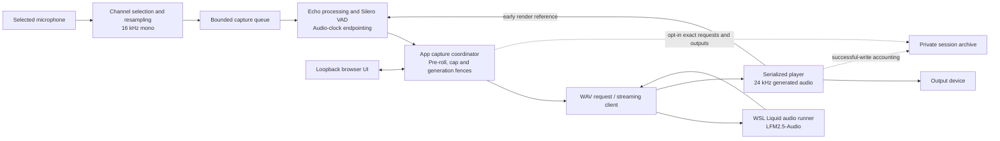
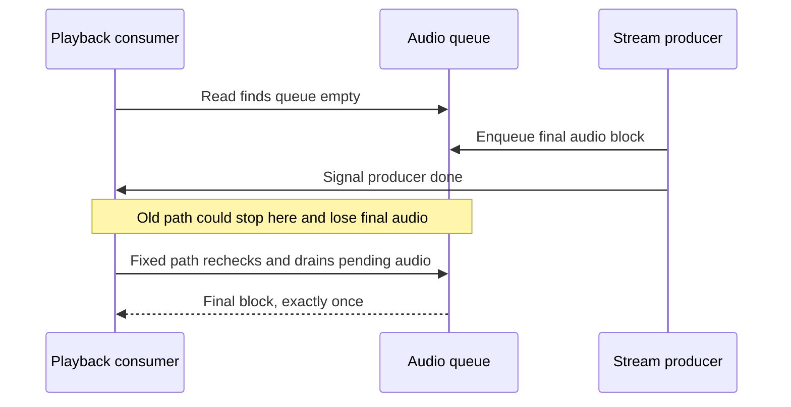

# Architecture

Turnwave runs a turn-based speech-to-speech model behind a continuously listening
application. LFM2.5-Audio consumes audio and generates audio directly; normal
inference does not require an ASR → text model → TTS chain. The application adds
capture, interruption, cancellation and recovery. This is not a native full-duplex model.

## Capture and turn ownership

`audio_io.Mic` selects a channel and resamples before the bounded `CaptureQueue`.
`duplex.DuplexFrontend` combines echo-reference processing, voice activity detection
and silence endpointing. `app.py` owns the nominal 250 ms pre-roll, 20-second
capture cap and cancellable request lifecycle. Queue bounds limit stale audio;
generation fences prevent callbacks from a retired capture entering a new turn.

Speaking during a reply can cancel it and begin a replacement turn. The native
runner cannot truncate conversation state to the exact audio already heard, so
interruption recovery resets model context. This sacrifices earlier memory.
An OS-backed exclusive backend lease prevents app and benchmark processes from
sharing one stateful conversation, including when the app is muted.

## Reversible floor (experimental)

The default barge-in path is deliberately conservative: a confirmed onset
aborts the reply, stops playback and resets context. `LOCALVOICE_FLOOR_MODE=reversible`
separates the reversible action from the irreversible one. An onset first
**ducks** playback (`Player.set_gain`, a short ramp applied to both the device
signal and the echo reference). While ducked, the app keeps the candidate audio
private. Sustained speech or a sufficiently long endpoint commits the floor and
cancels the reply; a short vocalisation is classified as a backchannel and
playback resumes without a context reset. `src/floor.py` owns the decision and
`src/app.py` applies it. This does not solve mid-turn pauses; that remains the
end-of-turn problem described in [results](RESULTS.md).

The offline replay `src/synth/floor_replay.py` drives the same policy with
authored barge-in shapes and writes a hard-versus-reversible comparison. It
opens no microphone, model or network connection.

## Streaming and playback

`client.py` sends WAV requests and decodes streaming text/audio events. Model text
and generated speech remain separate evidence. `audio_io.Player` sends an early
render reference to echo processing, then counts source samples after successful
device writes. Neither a generated WAV nor an accepted device write proves audibility.

The completion-race regression forces this ordering:

The forced fake-device test changed playback from 0/2,003 generated samples to
2,003/2,003, with a separate 3,443-sample control. It establishes the scheduling
fix, not the cause of every historical cutoff. See [results](RESULTS.md).

## Optional end-of-turn sidecar

`LOCALVOICE_EOT_MODEL=smart-turn` loads Smart Turn v3.2 and extends the
frontend's silence endpoint to `LOCALVOICE_EOT_TIMEOUT_MS` (default 1000 ms;
2000 ms lowers false cut-offs further at a longer worst-case wait). The first
query uses `LOCALVOICE_EOT_FIRST_THRESHOLD` (default 0.9); later queries use
`LOCALVOICE_EOT_THRESHOLD` (default 0.7). The app queries at 300 ms of silence
and then every 200 ms. A
confident score releases the turn immediately; an uncertain score keeps the
turn open until speech resumes or the timeout releases it. This is the
completion counterpart to the reversible floor: the floor decides whether a
sound takes the reply, while the EOT sidecar decides whether a silence ends the
user's turn. It is opt-in because it adds a model dependency and changes the
waiting behaviour; see [evaluation](EVALUATION.md) for the public-pause
diagnostic and its limits.

## Optional LFM3 realtime transport

The default client decodes server-sent events from the pinned Liquid runner.
`LOCALVOICE_TRANSPORT=realtime` selects `realtime_client.RealtimeClient`
instead. It uses llama.cpp's OpenAI-compatible `/v1/realtime` WebSocket with
LFM3-Audio-2B: user audio is appended as PCM16 chunks, committed, and the
response streams interleaved text and 24 kHz PCM. One socket carries context
between turns. The app's existing `first` flag opens a fresh socket, which is
how the current interruption/reset policy avoids a partially generated server
context. The client sends `response.cancel` when a turn is interrupted.

This path is opt-in and was validated on CPU only; GPU latency, long-session
context growth and real-device behavior remain open. The LFM2.5 SSE path and
its pinned runner are unchanged.

## UI, privacy and research boundaries

`ui.py` serves controls through `app.py` on loopback. Pending controls retain user
intent across stale polls; failures remain visible. Device indices come from the
app's own PortAudio catalog. Cached identity is reported only when it is complete
and uniquely matches; polling does not query audio hardware.

Normal diagnostics are distinct from opt-in `session_archive.py` audio archives.
Archives can retain exact requests, generated samples and cancellation/playback
metadata. They stay private. See [data handling](PRIVACY.md).

Optional transcription requires a separate model context. Moonshine/Namo semantic
endpoint studies and the selective opening-buffer candidate are research paths,
not the default shipped pipeline. The six-case opening comparison did not justify
adoption. No cloud API is part of the default inference path.
