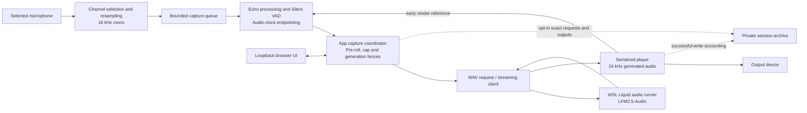
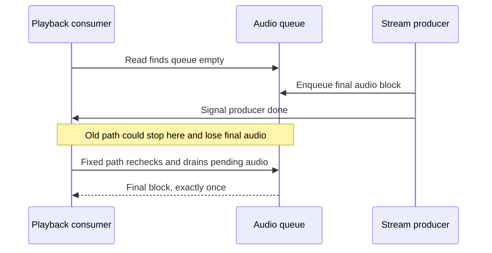

# Architecture

Turnwave runs a turn-based speech-to-speech model behind a continuously listening
application. LFM2.5-Audio consumes audio and generates audio directly; normal
inference does not require an ASR → text model → TTS chain. The application adds
capture, interruption, cancellation and recovery. This is not a native full-duplex model.

## Capture and turn ownership

`audio_io.Mic` selects a channel and resamples before the bounded `CaptureQueue`.
`duplex.DuplexFrontend` combines echo-reference processing, voice activity detection
and silence endpointing. `app.py` owns the nominal 250 ms pre-roll, 20-second
capture cap and cancellable request lifecycle. Queue bounds limit stale audio;
generation fences prevent callbacks from a retired capture entering a new turn.

Speaking during a reply can cancel it and begin a replacement turn. The native
runner cannot truncate conversation state to the exact audio already heard, so
interruption recovery resets model context. This sacrifices earlier memory.
An OS-backed exclusive backend lease prevents app and benchmark processes from
sharing one stateful conversation, including when the app is muted.

## Streaming and playback

`client.py` sends WAV requests and decodes streaming text/audio events. Model text
and generated speech remain separate evidence. `audio_io.Player` sends an early
render reference to echo processing, then counts source samples after successful
device writes. Neither a generated WAV nor an accepted device write proves audibility.

The completion-race regression forces this ordering:

The forced fake-device test changed playback from 0/2,003 generated samples to
2,003/2,003, with a separate 3,443-sample control. It establishes the scheduling
fix, not the cause of every historical cutoff. See [results](RESULTS.md).

## UI, privacy and research boundaries

`ui.py` serves controls through `app.py` on loopback. Pending controls retain user
intent across stale polls; failures remain visible. Device indices come from the
app's own PortAudio catalog. Cached identity is reported only when it is complete
and uniquely matches; polling does not query audio hardware.

Normal diagnostics are distinct from opt-in `session_archive.py` audio archives.
Archives can retain exact requests, generated samples and cancellation/playback
metadata. They stay private. See [data handling](PRIVACY.md).

Optional transcription requires a separate model context. Moonshine/Namo semantic
endpoint studies and the selective opening-buffer candidate are research paths,
not the default shipped pipeline. The six-case opening comparison did not justify
adoption. No cloud API is part of the default inference path.
