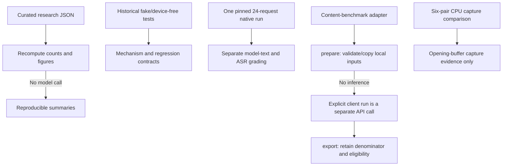

# Evaluation and evidence boundaries

The studies below measure separate parts of Turnwave. Their results are reported
individually rather than combined into an overall quality score. Included data
reproduce the counts and figures; rerunning historical model experiments also
requires the original stimuli, model assets, runtimes and settings.

## Evidence map



[`research/results.json`](../research/results.json) records each study's method,
denominator, outcome and limitations. The case files retain individual observations;
the [reply examples](../research/examples/README.md) include saved WAVs and separate
model text and machine transcripts. `scripts/build_research_figures.py` builds
charts from those data without running inference.

## Main observations

| Study | Observed result | What it supports | What it does not support |
|---|---|---|---|
| Playback completion race | A forced scheduling regression with fake devices: baseline generated 2,003 samples and played 0; fixed path generated and played all 2,003. A further 3,443 control samples were accounted for. | A deterministic regression test for the playback completion path. | The bug's historical frequency or a fresh acoustic benefit. |
| Selective opening controls | 16 deterministic controls, 6 source pairs and 18 acoustic pairs (14 eligible, 4 invalid). Baseline and candidate each passed 5 acoustic pairs; the candidate preserved baseline passes and recovered 160 ms and 180 ms in two known-source controls, plus 80 ms of quiet in the latter case. The overall acoustic gate failed. | A bounded synthetic mechanism test and a concrete limit: energy selection can include sustained noise or echo. | General voice quality, noise/echo safety, or promotion of the candidate. |
| Combined semantic development suite | 7/7 frozen old-suite pairs passed with 7 actual submissions. Paired semantic submission differences ranged from −2.919 to +1.425 ms; quiet fallback was 4.563624 s. | Narrow development-suite integration evidence. | Broad timing acceptance, room acceptance or answer quality. A separate fresh benchmark attempt did not produce a valid completed score. |
| Short-turn streaming capture and gate | One CPU synthetic diagnostic: 5/8 authored-complete cases released within 160 ms after the first raw VAD endpoint; all 8/8 unfinished prefixes stayed held for at least 2 seconds. All 16 cases were submitted once. | A measured timing-intent failure while the unfinished-prefix hold criterion passed. | Human conversation quality or a classifier-only benchmark; the metric includes capture/gate behavior and excludes the earlier silence wait. |
| Fixed-endpoint audio OR rule | On a separate first-endpoint screen, Namo-only accepted 5/8 complete intents and held 8/8 prefixes; the proposed OR rule accepted 7/8 complete intents but falsely accepted 4/8 prefixes, so it was rejected. | A fixed-snapshot tradeoff for this small authored set. | A calibrated threshold, later-score behavior, or impossibility of a better temporal/contextual policy. |
| Current capture path vs isolated opening candidate | One CPU-only, 20 ms step-paced run of 6 paired cases completed. Baseline and candidate detector events, capture intervals and captured bytes were identical in all six; 0 capture samples were added or removed. Noise-only and far-echo-only controls produced no event in either arm. The candidate remains private; recovery efficacy is unproven. | A narrow paired observation on two public audiobook clips from one speaker, plus seeded noise, synthetic echo, overlap, reset and mute controls. | Word-level recovery, intelligibility, arbitrary-room behavior or adoption. See `research/results.json` for the numerical summary. |
| Native content diagnostic | One actual 24-request run used the pinned native LFM2.5-Audio runner and fixed VoiceBench inputs. It saved audio for 24/24 requests; 18 completed normally and 6 reached the token limit. | A small, fixed content slice with separately graded model text and machine transcription. | A full VoiceBench benchmark, leaderboard result, human-heard accuracy or overall quality score. |

Two earlier capture-test attempts stopped during dependency checks before any
case ran. The completed run passed import preflight and finished all six pairs.

## Native 24-request content slice

The frozen slice used 12 OpenBookQA rows and 12 IFEval rows from the pinned VoiceBench revision. It ran once sequentially against the native GGUF runner with the recorded LFM2.5-Audio Q8 language model and Q4 projector/vocoder/tokenizer, `reset_context=true`, a 512-token limit and GPU layers requested at 99 on an RTX 3050 Laptop with 4 GiB. This was a native binary run, not reference PyTorch. All 24 generated audio files were saved; 18 replies ended normally and 6 reached the length limit. The median request-to-first-decoded-audio measurement was 0.3445 s; it excludes capture, endpointing and device playback.

The ledger pins the VoiceBench dataset revision `b02edcef1330480be3a11bd6f7434ac32f05ad08`, the historical source snapshot `438f7ce`, and native runner SHA-256 `b25c5b29174bf35bf90e58287ba4e5250fcdde92a3db6232b485850e95c7c974`. It also records the separate classifier revisions: Namo `4dcc9713be5071ef43e510f72b1eefcb2f99cb04` and Turn-1-mini `076c86d1744a231d3a4cce31f3bbbd1211b4c281` with graph SHA-256 `e747b182d685c7db489a3ea2e12bdcd65bac506fcddec00ed3cd0bf9f209fd11`.

Strict OpenBookQA matches were 4/12 for generated model text and 2/12 for independent ASR transcripts. The official IFEval strict/loose prompt pass was 2/12 for each source; instruction-level passes were 3/14 for each source. The six length-limited replies remain in the denominator and are ineligible for accepted IFEval grading. Model text and ASR are kept separate; ASR is recognition evidence, not human adjudication.

VoiceBench's upstream multiple-choice path can fall back to random A–D guesses when answer extraction fails. The reported strict answer match gives no random-guess credit. The seeded upstream raw result is retained separately and is not presented as a strict accuracy measure. Do not combine the IFEval and multiple-choice results into one score. The sample is selected and small, not an official full-benchmark result or leaderboard ranking.

## Content-benchmark adapter

`src/synth/content_benchmark.py` currently exposes `prepare` and `export` CLI commands. Both are local data operations: `prepare` validates a caller-supplied manifest and copies the declared local WAVs into a new prepared directory; it does not download a dataset or invoke a model. `export` checks a saved run and writes scorer-format rows while retaining every expected case and recording ineligible responses. Optional ASR must be supplied separately with source provenance; model text is never substituted for ASR, and no judge is called.

```powershell
python -m src.synth.content_benchmark prepare path/to/reviewed-manifest.json outputs/benchmark-prepared
python -m src.synth.content_benchmark export outputs/benchmark-run outputs/benchmark-grades --asr path/to/independent-asr.json
```

The input manifest has `version: 1`, a dataset name, a 40-character source revision,
and nonempty `cases`. Each case supplies a unique safe `id`, `subset` (`ifeval`
or `openbookqa`), relative `audio` path, input `sha256` and scorer `metadata`.
Inputs must be nonempty 16 kHz mono PCM16 WAVs. Keep source data and run outputs
under ignored local folders and review their terms before use.

Inference is available through the Python API `infer_injected(...)`, with a
caller-supplied client and provenance. A real `ServerClient` reserves exclusive
backend ownership. Unit tests use injected fake clients and neutral generated fixtures. Those tests prove input, output, cancellation, hashing and denominator contracts, not model quality. `requirements-eval.txt` adds the pinned local ASR evaluation dependencies; it does not supply a dataset, a model, or permission to contact a judge.

## Floor replay

`src/synth/floor_replay.py` is an offline policy/timing diagnostic for the
experimental reversible floor. It feeds authored barge-in shapes (short
backchannels, a cough, a short command, sustained speech, a mid-turn pause and
echo-only) to the same `FloorPolicy` the app uses, for both hard and reversible
modes. It writes per-case decisions and a small A/B summary:

```powershell
python -m src.synth.floor_replay --out outputs/floor_replay.json
```

The frozen cases are authored shapes, not human conversation. The mid-pause case
is a known end-of-turn limitation and is counted separately. Commit latency is
measured from the confirmed onset and excludes device, model and playback
latency. Passing this replay is a prerequisite for a real-device A/B, not
evidence that reversible mode improves live conversation.

## LFM3 realtime smoke test

`src/synth/lfm3_smoke.py` sends one public example WAV through the LFM3
`/v1/realtime` client and saves the returned 24 kHz audio. On one warm local GPU
run, the reply text was “Got it, you mentioned buying a blue lamp. What would
you like to know about it?”, first audio arrived at 0.679 s, and the reply was
5.04 s long with `finish_reason=stop`. Re-running LFM3 ASR over the saved reply
returned the same sentence. This is a transport and intelligibility smoke test,
not a latency benchmark: it is one clip, one machine, and the ASR is the same
model family rather than an independent judge.

```powershell
python -m src.synth.lfm3_smoke --wav research/examples/pass-reply.wav \
  --url ws://127.0.0.1:8080/v1/realtime --out outputs/lfm3-reply.wav
```

A small public ASR check used the first 20 clips of the LibriSpeech dummy
fixture through LFM3-Audio-2B Q4_K_M on CPU. Corpus WER was 5.74% and sentence
error rate 65%; per-clip latency ranged from 0.9 s to 9.0 s. This is clean read
speech from a small speaker subset, not a full LibriSpeech or noisy-speech
benchmark.

```powershell
python scripts/lfm3_asr_bench.py --limit 20 --url http://127.0.0.1:8091
```

## Acoustic floor stress replay

`src/synth/floor_acoustic.py` drives the real `DuplexFrontend` (Silero VAD,
WebRTC AEC and echo correlation) with a public human LibriSpeech near-end and a
generated far-end, plus a delayed attenuated echo. It is a stress test, not a
room study.

On four cases at 20 ms steps, both hard and reversible modes started on 3/4
(echo-only did not start) and committed 3/3. The 220 ms backchannel produced
about 316 ms of VAD evidence in this synthetic double-talk, so it crossed the
300 ms commit threshold instead of resuming. This is a negative transfer result:
the authored 3/3 backchannel preservation in the policy replay did not survive
the real frontend and echo. The reversible path still ducked first and delayed
the commit by about 220 ms, but it did not preserve the turn.

The acoustic result is a reason the reversible feature remains opt-in. The app's
default uses deferred interruption; `hard` is an explicit experimental mode.
Backchannel preservation needs either better double-talk
evidence, a different duration/energy policy, or real-device tuning.

The separate delayed-tail comparison in [results](RESULTS.md) stops adding the
render reference after playback ends and evaluates standard versus experimental
long echo history. It includes near-only and overlapping speech controls; the
long profile reduces synthetic echo-only starts while delaying some quiet speech.

## Public-pause EOT diagnostic

`src/synth/eot_bench.py` scores the English validation split of
`livekit/eot-bench-data` with Smart Turn v3.2. It treats every pause long enough
to reach a decision time as a case: a mid-turn pause that crosses the threshold
is a false cut-off, and a trailing pause that crosses it is an end-of-turn
detection. The 300 ms budget produced 864 pause cases (464 mid-turn, 400 final).

All rows below use the **same 864 pauses of at least 300 ms** (464 mid-turn, 400
final). An earlier draft mixed pause sets and is superseded.

| Policy | False cut-off | EOT recall | p90 final latency |
| --- | ---: | ---: | ---: |
| Fixed 480 ms endpoint | 61.64% | 100% | 480 ms |
| One Smart Turn query at 300 ms | 23.28% | 76% | 300 ms |
| Re-query every 200 ms, no timeout | 26.29% | 83% | 900 ms |
| Re-query + 1 s timeout, 0.9/0.7 schedule | 27.37% | 100% | 1000 ms |
| Re-query + 2 s timeout, 0.9/0.7 schedule | 16.59% | 100% | 2000 ms |

Wilson 95% intervals for the false cut-off rate were 57.13–65.95% for the fixed
endpoint, 23.51–31.60% for the 1 s schedule and 13.49–20.25% for the 2 s
schedule. The threshold-free AUC was 0.84 at 300 ms, 0.85 at 500 ms and 0.85 at
800 ms. The 1 s schedule is the default behind `LOCALVOICE_EOT_MODEL=smart-turn`;
the 2 s timeout is the lower-false-cut-off option. Most final turns commit at
the 300 ms query, while uncertain turns are bounded by the timeout. The single
300 ms query has the lowest false cut-off but misses 24% of final pauses; the
timeout recovers those turns. Re-querying without a timeout increases false
cut-offs relative to one query (26.29% vs 23.28%) because a mid-turn pause gets
more chances to cross the threshold.

The 0.9-first / 0.7-later schedule was selected by sweeping the saved scores on
the same 864 pauses. To check that selection without leaking a conversation
across halves, conversations were split deterministically by even/odd group:
thresholds were chosen on 48 conversations and scored once on the other 48
(466 pauses, 255 mid-turn).

| Held-out policy | False cut-off (95% CI) | EOT recall | p90 latency |
| --- | ---: | ---: | ---: |
| Fixed 480 ms | 63.92% (57.86–69.57) | 100% | 480 ms |
| One 300 ms query at 0.5 | 23.14% (18.38–28.69) | 72.51% | 300 ms |
| 0.9/0.7 + 1 s timeout | 31.37% (25.99–37.31) | 100% | 1000 ms |
| 0.9/0.7 + 2 s timeout | 19.22% (14.85–24.49) | 100% | 2000 ms |

This is the less biased estimate and the one used for the headline claim. It is
still one deterministic English conversation split, not multi-seed or live
acceptance. The earlier row-level split was superseded because it could place
turns from the same conversation on both sides.

### Zero-shot cross-lingual check

The English thresholds were applied unchanged to German (`de`) and Spanish
(`es`) from the same public dataset, 400 turns each and the same pause
eligibility rule. Cells are false cut-off / EOT recall.

| Language | Fixed 480 ms | 0.9/0.7 + 1 s | 0.9/0.7 + 2 s |
| --- | ---: | ---: | ---: |
| German | 62.95% / 95.64% | 45.40% / 100% | 39.55% / 100% |
| Spanish | 67.25% / 97.72% | 59.22% / 100% | 52.93% / 100% |

The schedule still beats the fixed endpoint, but transfer is weak: German false
cut-off is about double the English held-out estimate, and Spanish improves only
modestly. A stricter first query avoids many premature commits but misses more
finals; the later 0.7 query then admits many mid-pauses in both languages. These
results support per-language calibration rather than assuming English thresholds
are universal. This is a negative transfer result, not a multilingual win.
Other public turn-taking sets were not run: `Krisp-AI/turn-taking-test-v1` and
`vapi-ai/eotd-multilingual` are gated, and `mundo-ai/turn-benchmark-*` shards
are multi-gigabyte.

### Query latency

On this CPU (ONNX Runtime, one inter-op thread), Smart Turn v3.2 on 8 s clips
measured a 55.47 ms mean, 47.76 ms median and 81.93 ms p90 over 19 warm calls.
The 300 ms first-query schedule has enough headroom for this hardware; the
measurement is one local run, not a hardware-independent benchmark.

As a descriptive per-turn check, restrict to the 165 turns that contain a
mid-turn pause of at least 300 ms. The fixed 480 ms endpoint cut off 125/165
(75.8%) of those turns; one Smart Turn query at 300 ms cut off 77/165 (46.7%).
This is a different denominator from the per-pause table and is not used for
the policy decision.

These are per-pause observations on public English conversational audio, not
per-turn or real-device results. The labels are derived from the dataset's
silence timing, not human adjudication of intent. Smart Turn is scored offline
with Whisper features; the diagnostic excludes the app's microphone, AEC,
playback and model latency. It is evidence for a bounded policy, not a claim of
universal endpointing accuracy.

Run it with:

```powershell
python -m pip install -r requirements-eot.txt
python -m src.synth.eot_bench --limit 400 --out outputs/eot_bench.json
```


## LFM3 standard and research model: paired text pilot

On 2026-11-05 we compared two local Q4 GGUF models using the same CPU
llama-server build `b12032-dde879bc4`, projector, settings and prompts. This
is a bounded experiment, not evidence that either model is safe or generally
more capable. The research model was produced in a Heretic experiment; the
standard model is the unmodified comparison. Model SHA-256 values:

- Standard: `9f8d30e9d4fd7a9349d586e077988229b3ca0a0e4ad730897563d1eccc9893e2`
- Research: `55dd5a234f1343dd8429e64b83ab297ad9540fb0d01a6d877e99a07718990390`
- Shared projector: `0a746c0794782a16d4456b230c2a0b5888a2d94a6677211edbed7d7a4177a39a`

The primary sample used 20 harmful-behavior prompts, 20 benign prompts and
16 authored exact-answer controls. The harmful and benign slices were distinct
from the earlier fit and held-out slices, but came from the same datasets. Each
arm used temperature 0, seed 42 and a 64-token cap. All 112 calls completed;
none was empty. The table shows counts for standard / research respectively.

| Group | Refusal-marker matches | Truncated | Exact controls correct |
| --- | ---: | ---: | ---: |
| Harmful (20) | 19 / 15 | 20 / 20 | — |
| Benign (20) | 0 / 0 | 15 / 17 | — |
| Authored controls (16) | — | 0 / 0 | 13 / 12 |

The four harmful marker differences were standard-only. Of the controls, 12
passed in both arms, one passed only in standard, and three failed in both.
Marker detection is simple keyword matching, **not** a semantic refusal or
compliance judgment; the 64-token cap truncated every harmful response and
most benign ones. The small authored controls are not a general capability test.

A longer-output check repeated the first five cases from each dataset at 192
tokens; it is a subset, not independent confirmation. For harmful prompts,
marker matches were 5 / 5 in each arm and truncations 2 / 4. For benign prompts,
marker matches were 0 / 1 and truncations 4 / 3. All 20 calls completed and
none was empty. The change in counts across caps illustrates why keyword
counts must not be interpreted as refusal rates. These results do not measure
voice quality, audio comprehension, human preference, safety or real-world
performance. Further evaluation needs more diverse independent prompts,
human-reviewed responses and voice tests.

The evaluator records per-case outcomes, hashes, errors and timing but never
stores prompts or responses. Its evidence stays under ignored `outputs/`;
the aggregate counts above are the public record. Server identity is checked
against its reported model path, not cryptographic proof of loaded memory.
The local model files are hashed before and after each run. To reproduce, install
`datasets`, start each model separately with identical flags (`NGL=0`,
`MMOFFLOAD=0`, context 4096, parallel 1), and use the commands in
`scripts/compare_lfm_variants.py`. Pass `--profile extended` for the repeated
192-token subset. Datasets and exact revisions and slices are pinned in that
script. Use new output paths for each run; existing evidence is never overwritten.

## Reproduce summaries and checks

Run from the repository root. Install development dependencies for the suite and
optional plotting dependencies for charts. These commands do not run neural inference:

```powershell
python -m pip install -r requirements-dev.txt
python -m pip install -r requirements-docs.txt
python -m pytest tests -q
python -m src.synth.floor_replay --out outputs/floor_replay.json
python -m src.synth.floor_acoustic --out outputs/floor_acoustic.json
python scripts/eot_latency.py
python scripts/eot_crosslingual.py --languages de es
python -m src.synth.eot_bench --limit 400 --out outputs/eot_bench.json
python scripts/eot_recompute.py
python scripts/eot_schedule_sweep.py
python scripts/eot_holdout.py
python scripts/eot_per_turn.py
python scripts/export_research_summaries.py
python scripts/verify_research.py
python scripts/check_publication.py --worktree
python scripts/build_research_figures.py
```

`verify_research.py` recomputes the frozen timing and screen counts, checks the six-pair capture denominator and decision, and verifies the two included example WAV hashes/formats. The test suite covers deterministic application contracts, the adapter's local prepare/export behavior and the publication manifest guard. The publication scan checks the current worktree, including untracked files; it does not scan or sanitize old Git history. The chart command uses the figure-builder and curated inputs to regenerate the published figures only.

To reproduce historical neural results exactly, obtain the same frozen private source inputs, model assets, native/runtime binaries, configuration and hardware, then follow the corresponding saved protocol. Those assets are not included here. No chart or unit test silently substitutes for a model rerun.

## Boundaries

The authored short-turn labels express the experimenter's intended task, not spontaneous-human ground truth. Public audiobook utterances are not conversational speech. Fixed 20 ms energy regions and full-recording nonzero spans are descriptive signal provenance, not word boundaries. No human recording, SAPI-rendered stimulus, third-party benchmark audio, model weights, native binary, private raw trace or private Git history is included in the public research bundle. Application code and documentation use the [MIT license](../LICENSE); [model and dependency terms](THIRD_PARTY.md) are separate.

## Release validation on 2026-10-18

The complete automated suite passed **390 tests** in the development checkout
and **390 tests** in the separate public copy (Python 3.12). The evidence verifier,
publication worktree/index checks and local documentation-link checks passed.
Figures were rebuilt reproducibly with Matplotlib 3.10.0 and NumPy 2.1.3 and both
PNG outputs were visually inspected. The initial fresh GitHub Windows job passed
384 tests and skipped the six WSL-dependent build contracts because Ubuntu WSL
was unavailable. A separate Ubuntu job runs those six shell contracts with fake
tools; it does not compile the native runner. Current results are visible in
[GitHub Actions](https://github.com/Arudchayan/Turnwave/actions/workflows/tests.yml).
A fresh-machine native build and real-device acceptance remain unvalidated.
