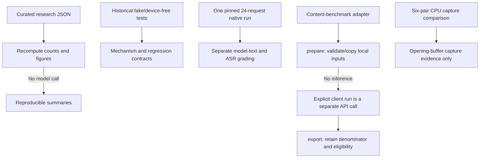

# Evaluation and evidence boundaries

The studies below measure separate parts of Turnwave. Their results are reported
individually rather than combined into an overall quality score. Included data
reproduce the counts and figures; rerunning historical model experiments also
requires the original stimuli, model assets, runtimes and settings.

## Evidence map



[`research/results.json`](../research/results.json) records each study's method,
denominator, outcome and limitations. The case files retain individual observations;
the [reply examples](../research/examples/README.md) include saved WAVs and separate
model text and machine transcripts. `scripts/build_research_figures.py` builds
charts from those data without running inference.

## Main observations

| Study | Observed result | What it supports | What it does not support |
|---|---|---|---|
| Playback completion race | A forced scheduling regression with fake devices: baseline generated 2,003 samples and played 0; fixed path generated and played all 2,003. A further 3,443 control samples were accounted for. | A deterministic regression test for the playback completion path. | The bug's historical frequency or a fresh acoustic benefit. |
| Selective opening controls | 16 deterministic controls, 6 source pairs and 18 acoustic pairs (14 eligible, 4 invalid). Baseline and candidate each passed 5 acoustic pairs; the candidate preserved baseline passes and recovered 160 ms and 180 ms in two known-source controls, plus 80 ms of quiet in the latter case. The overall acoustic gate failed. | A bounded synthetic mechanism test and a concrete limit: energy selection can include sustained noise or echo. | General voice quality, noise/echo safety, or promotion of the candidate. |
| Combined semantic development suite | 7/7 frozen old-suite pairs passed with 7 actual submissions. Paired semantic submission differences ranged from −2.919 to +1.425 ms; quiet fallback was 4.563624 s. | Narrow development-suite integration evidence. | Broad timing acceptance, room acceptance or answer quality. A separate fresh benchmark attempt did not produce a valid completed score. |
| Short-turn streaming capture and gate | One CPU synthetic diagnostic: 5/8 authored-complete cases released within 160 ms after the first raw VAD endpoint; all 8/8 unfinished prefixes stayed held for at least 2 seconds. All 16 cases were submitted once. | A measured timing-intent failure while the unfinished-prefix hold criterion passed. | Human conversation quality or a classifier-only benchmark; the metric includes capture/gate behavior and excludes the earlier silence wait. |
| Fixed-endpoint audio OR rule | On a separate first-endpoint screen, Namo-only accepted 5/8 complete intents and held 8/8 prefixes; the proposed OR rule accepted 7/8 complete intents but falsely accepted 4/8 prefixes, so it was rejected. | A fixed-snapshot tradeoff for this small authored set. | A calibrated threshold, later-score behavior, or impossibility of a better temporal/contextual policy. |
| Current capture path vs isolated opening candidate | One CPU-only, 20 ms step-paced run of 6 paired cases completed. Baseline and candidate detector events, capture intervals and captured bytes were identical in all six; 0 capture samples were added or removed. Noise-only and far-echo-only controls produced no event in either arm. The candidate remains private; recovery efficacy is unproven. | A narrow paired observation on two public audiobook clips from one speaker, plus seeded noise, synthetic echo, overlap, reset and mute controls. | Word-level recovery, intelligibility, arbitrary-room behavior or adoption. See `research/results.json` for the numerical summary. |
| Native content diagnostic | One actual 24-request run used the pinned native LFM2.5-Audio runner and fixed VoiceBench inputs. It saved audio for 24/24 requests; 18 completed normally and 6 reached the token limit. | A small, fixed content slice with separately graded model text and machine transcription. | A full VoiceBench benchmark, leaderboard result, human-heard accuracy or overall quality score. |

Two earlier capture-test attempts stopped during dependency checks before any
case ran. The completed run passed import preflight and finished all six pairs.

## Native 24-request content slice

The frozen slice used 12 OpenBookQA rows and 12 IFEval rows from the pinned VoiceBench revision. It ran once sequentially against the native GGUF runner with the recorded LFM2.5-Audio Q8 language model and Q4 projector/vocoder/tokenizer, `reset_context=true`, a 512-token limit and GPU layers requested at 99 on an RTX 3050 Laptop with 4 GiB. This was a native binary run, not reference PyTorch. All 24 generated audio files were saved; 18 replies ended normally and 6 reached the length limit. The median request-to-first-decoded-audio measurement was 0.3445 s; it excludes capture, endpointing and device playback.

The ledger pins the VoiceBench dataset revision `b02edcef1330480be3a11bd6f7434ac32f05ad08`, the historical source snapshot `438f7ce`, and native runner SHA-256 `b25c5b29174bf35bf90e58287ba4e5250fcdde92a3db6232b485850e95c7c974`. It also records the separate classifier revisions: Namo `4dcc9713be5071ef43e510f72b1eefcb2f99cb04` and Turn-1-mini `076c86d1744a231d3a4cce31f3bbbd1211b4c281` with graph SHA-256 `e747b182d685c7db489a3ea2e12bdcd65bac506fcddec00ed3cd0bf9f209fd11`.

Strict OpenBookQA matches were 4/12 for generated model text and 2/12 for independent ASR transcripts. The official IFEval strict/loose prompt pass was 2/12 for each source; instruction-level passes were 3/14 for each source. The six length-limited replies remain in the denominator and are ineligible for accepted IFEval grading. Model text and ASR are kept separate; ASR is recognition evidence, not human adjudication.

VoiceBench's upstream multiple-choice path can fall back to random A–D guesses when answer extraction fails. The reported strict answer match gives no random-guess credit. The seeded upstream raw result is retained separately and is not presented as a strict accuracy measure. Do not combine the IFEval and multiple-choice results into one score. The sample is selected and small, not an official full-benchmark result or leaderboard ranking.

## Content-benchmark adapter

`src/synth/content_benchmark.py` currently exposes `prepare` and `export` CLI commands. Both are local data operations: `prepare` validates a caller-supplied manifest and copies the declared local WAVs into a new prepared directory; it does not download a dataset or invoke a model. `export` checks a saved run and writes scorer-format rows while retaining every expected case and recording ineligible responses. Optional ASR must be supplied separately with source provenance; model text is never substituted for ASR, and no judge is called.

```powershell
python -m src.synth.content_benchmark prepare path/to/reviewed-manifest.json outputs/benchmark-prepared
python -m src.synth.content_benchmark export outputs/benchmark-run outputs/benchmark-grades --asr path/to/independent-asr.json
```

The input manifest has `version: 1`, a dataset name, a 40-character source revision,
and nonempty `cases`. Each case supplies a unique safe `id`, `subset` (`ifeval`
or `openbookqa`), relative `audio` path, input `sha256` and scorer `metadata`.
Inputs must be nonempty 16 kHz mono PCM16 WAVs. Keep source data and run outputs
under ignored local folders and review their terms before use.

Inference is available through the Python API `infer_injected(...)`, with a
caller-supplied client and provenance. A real `ServerClient` reserves exclusive
backend ownership. Unit tests use injected fake clients and neutral generated fixtures. Those tests prove input, output, cancellation, hashing and denominator contracts, not model quality. `requirements-eval.txt` adds the pinned local ASR evaluation dependencies; it does not supply a dataset, a model, or permission to contact a judge.

## Reproduce summaries and checks

Run from the repository root. Install development dependencies for the suite and
optional plotting dependencies for charts. These commands do not run neural inference:

```powershell
python -m pip install -r requirements-dev.txt
python -m pip install -r requirements-docs.txt
python -m pytest tests -q
python scripts/verify_research.py
python scripts/check_publication.py --worktree
python scripts/build_research_figures.py
```

`verify_research.py` recomputes the frozen timing and screen counts, checks the six-pair capture denominator and decision, and verifies the two included example WAV hashes/formats. The test suite covers deterministic application contracts, the adapter's local prepare/export behavior and the publication manifest guard. The publication scan checks the current worktree, including untracked files; it does not scan or sanitize old Git history. The chart command uses the figure-builder and curated inputs to regenerate the published figures only.

To reproduce historical neural results exactly, obtain the same frozen private source inputs, model assets, native/runtime binaries, configuration and hardware, then follow the corresponding saved protocol. Those assets are not included here. No chart or unit test silently substitutes for a model rerun.

## Boundaries

The authored short-turn labels express the experimenter's intended task, not spontaneous-human ground truth. Public audiobook utterances are not conversational speech. Fixed 20 ms energy regions and full-recording nonzero spans are descriptive signal provenance, not word boundaries. No human recording, SAPI-rendered stimulus, third-party benchmark audio, model weights, native binary, private raw trace or private Git history is included in the public research bundle. Application code and documentation use the [MIT license](../LICENSE); [model and dependency terms](THIRD_PARTY.md) are separate.

## Release validation on 2026-10-18

The complete automated suite passed **390 tests** in the development checkout
and **390 tests** in the separate public copy (Python 3.12). The evidence verifier,
publication worktree/index checks and local documentation-link checks passed.
Figures were rebuilt reproducibly with Matplotlib 3.10.0 and NumPy 2.1.3 and both
PNG outputs were visually inspected. The initial fresh GitHub Windows job passed
384 tests and skipped the six WSL-dependent build contracts because Ubuntu WSL
was unavailable. A separate Ubuntu job runs those six shell contracts with fake
tools; it does not compile the native runner. Current results are visible in
[GitHub Actions](https://github.com/Arudchayan/Turnwave/actions/workflows/tests.yml).
A fresh-machine native build and real-device acceptance remain unvalidated.
