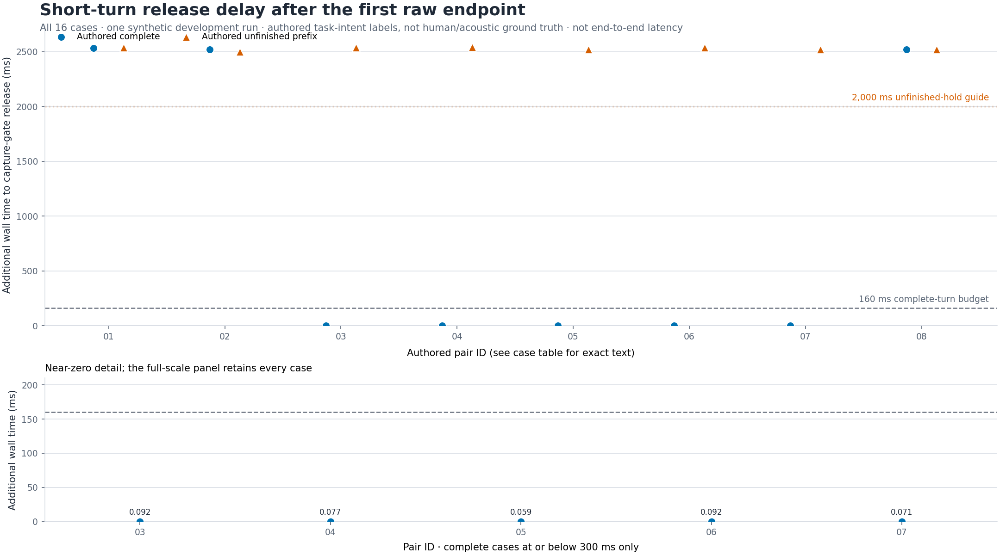
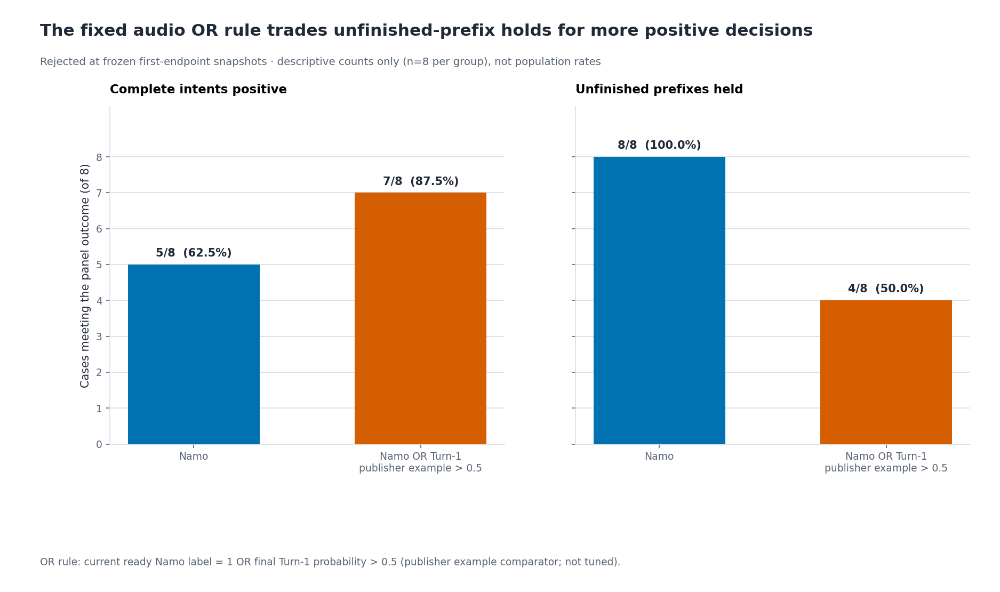

# Results and lessons

These are bounded engineering results from different frozen snapshots. They are
not a whole-app acceptance score, an official leaderboard submission or evidence
that conversation is consistently smooth. Numerical observations and provenance
are in [results.json](../research/results.json); chart rows and two genuine
generated reply examples are public. Raw private logs and recordings are not.

| Question | Evidence | Result | Decision |
| --- | --- | --- | --- |
| Can completion race with the final playback block? | Forced queue/producer ordering with fake devices | 0/2,003 → 2,003/2,003 samples played; separate 3,443-sample control | Fix implemented |
| Does the semantic gate release short completed requests promptly? | One 16-case synthetic streaming diagnostic | 5/8 completed intents within 160 ms extra; 8/8 unfinished intents held at least 2 seconds | Timing intent failed |
| Does adding a fixed audio detector solve that tradeoff? | First-endpoint screen on the same 16 development inputs | Completed positives 5→7/8, unfinished held 8→4/8 | Reject the fixed OR rule |
| Does selective extra pre-roll improve fresh capture? | Six frozen paired CPU cases, 12 arms | Events and captured bytes identical in every pair | Do not adopt; benefit unproven |
| Does native generation follow content tasks? | Adapted 24-request VoiceBench slice | 18 normal completions, 6 length-limited | Diagnostic baseline only |

## A timing failure worth preserving

The measurement starts at the **first inner raw VAD endpoint** and stops when the
capture gate releases. It excludes the detector's preceding silence wait, model
generation, output buffering and devices. Each row is one observation; there are
no repeat-run confidence intervals. Labels describe authored intent, not human
conversational ground truth.

“Why?”, “Really?” and “And you?” waited approximately 2.52 seconds for quiet fallback.
All eight unfinished prefixes were held at least two seconds. This was a helper
capture/endpoint diagnostic, with no LFM answer generation. At the first raw
endpoint those three completed requests already had correctly punctuated helper
transcripts; later text could change before fallback. Missing punctuation alone
does not explain the result. A separate helper transcription mapped “Mine” to
“Mug”; that is not evidence of LFM misunderstanding.

## Rejected: a simple audio-detector OR rule

The screen combined Namo's completed decision with Turn-1-mini's last fully
observed 160 ms step at score >0.5. This is the publisher example threshold,
not a separate benchmark threshold. It rescued “Why?” and “And you?” but still
missed “Really?”. Four unfinished prefixes became positive: “Before you…”,
“Please put the…”, “Which one should…” and “And you should…”.

At these fixed snapshots, holding all prefixes requires a threshold at least
0.908043920994, while rescuing all three misses requires a threshold below
0.283335864544. That rules out a separating scalar threshold **on these points**;
it says nothing universal about temporal or context-aware policies. The 121 CPU
steps and isolated maximum step time are not an end-to-end responsiveness test.
Reserved voices and remaining held-out cases were not consumed to repeat a
known failing rule. See the [16 scored rows](../research/candidate-screen-cases.json).

## Not adopted: selective opening history

The private candidate can extend pre-roll when adjacent energy windows indicate
sustained onset. Earlier known synthetic controls recovered 160 ms and 180 ms of
voice in two cases, but the acoustic suite remained 5/14 eligible passes (18 total,
four invalid-source cases) for both baseline and candidate. Energy cannot identify
whether sustained content is near speech, noise or echo.

The fresh comparison used two public audiobook utterances from one speaker:
clean onset, reduced-gain onset, seeded noise, echo-only, synthetic double-talk,
and reset/mute/fresh-input lifecycle. All six pairs completed once on CPU, with
20 ms callback steps. All 27 source/runtime and five frozen artifact pins matched.
The candidate added and removed **zero capture samples**; events and capture
hashes were identical. Noise-only and echo-only produced no starts/captures;
mute/reset controls matched, with no muted source captured.

This supports bounded non-regression, not efficacy. Some source PCM preceded
capture, but nonzero PCM is not a word boundary; we do not claim lost words.
The run used actual capture/queue/frontend code without a backend, ASR, model
reply, microphone or speaker. Two earlier attempts stopped on dependency-import
guards before neural execution; those are preserved setup failures, not voice
quality failures. The candidate remains private. Full sanitized case intervals,
hashes and source/runtime pins are in `public_capture_comparison` in results.json.

## Native content baseline: 24 actual generated answers

This historical run made 12 IFEval and 12 OpenBookQA requests through the native
GGUF runner, resetting context for each request and limiting output to 512 tokens.
It used a Q8 language model with Q4 components on an RTX 3050 Laptop (4 GiB),
requesting 99 GPU layers. It is not the reference PyTorch configuration.

| Measure | Model-emitted text | Independent generated-audio ASR |
| --- | --- | --- |
| OpenBookQA strict parsed correct | 4/12 | 2/12 |
| IFEval strict prompt pass | 2/12 | 2/12 |
| IFEval strict instruction pass | 3/14 | 3/14 |

All 24 outputs were saved; 18 completed normally and six IFEval outputs hit the
length limit. Failed/length-limited requests remain in denominators and cannot
earn accepted grading credit. Random upstream multiple-choice fallback credit
is excluded. Base.en ASR is unadjudicated recognition evidence: text/ASR
disagreements and extraction failures do not by themselves prove unclear audio.

Median request-to-first-decoded-audio was **344.5 ms**. It excludes capture,
endpointing, playback and room latency. The 361.28 seconds of saved generated
audio were not played in this test. This selected slice is not a full VoiceBench
result and cannot rank this system against other implementations.

## Successful narrow controls still need fresh tests

An older combined semantic suite passed 7/7 synthetic development cases, including
two stop commands and a joined sentence. It made seven actual submissions, with
no generated-answer evaluation. A separate fresh attempt failed. The lesson is
to retain development passes while distinguishing them from generalization.

The [two synthetic reply examples](../research/examples/README.md) similarly show
one text-rubric pass and one ownership failure. They are selected illustrations,
not a two-case accuracy estimate or evidence that a particular voice caused failure.

## What remains open

False interruptions, paused-sentence behavior and reply quality remain known
limitations and are parked while preparing this release. Controlled real-device
acceptance and a clean-machine native installation are not established by the
published unit suite. We do not claim SOTA, production readiness or solved smoothness.
See [evaluation boundaries and reproduction](EVALUATION.md).
