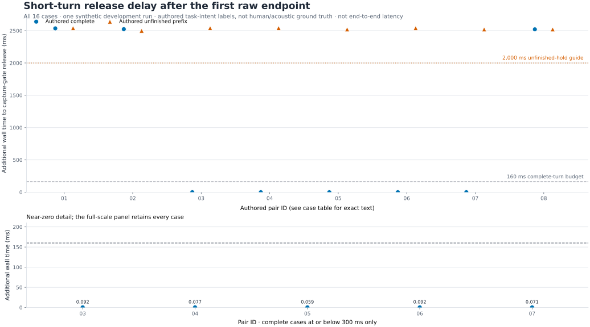
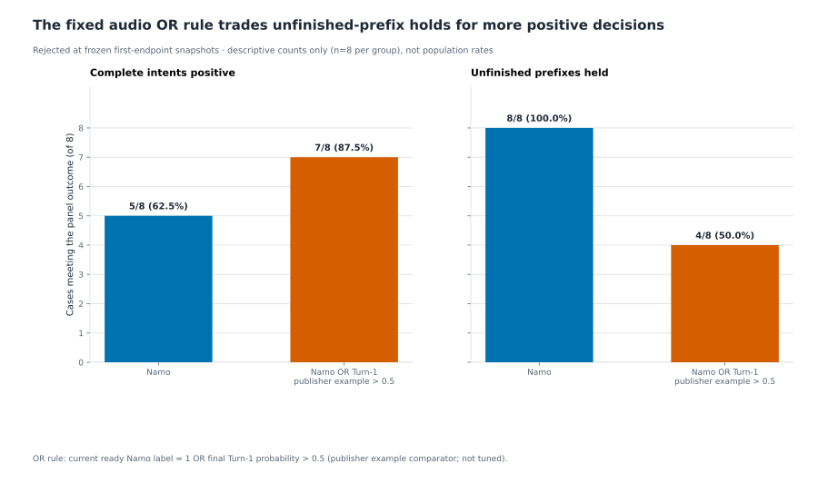

# Experiment data and figures

This directory contains the data behind the [results](../docs/RESULTS.md),
including unsuccessful approaches and example model outputs.

| File | Contents |
| --- | --- |
| [results.json](results.json) | Study summaries, denominators, decisions and source hashes |
| [short-turn-cases.json](short-turn-cases.json) | All 16 observations from the streaming completion diagnostic |
| [candidate-screen-cases.json](candidate-screen-cases.json) | All 16 fixed-endpoint scores for the rejected audio OR rule |
| [examples](examples/README.md) | Two complete generated replies, model text and independent ASR |
| [publication-manifest.json](publication-manifest.json) | Asset sizes, formats, provenance and SHA-256 hashes |

## Reproduce the summaries

```powershell
python scripts/verify_research.py
python -m pip install -r requirements-docs.txt
python scripts/build_research_figures.py
```

The verifier recalculates counts and checks the example audio hashes and formats.
The figure builder uses the saved observations; neither command runs a model.
Exact historical inference reruns require additional source inputs and runtime
assets that are not distributed here. See [evaluation](../docs/EVALUATION.md) for
methods, source revisions and reproduction boundaries.

## Figures

Each point in the delay chart is one observation. The completion chart reports
counts from eight completed and eight unfinished authored inputs.





## Source material

This bundle includes summaries, charts and generated reply examples. It excludes
participant recordings, source benchmark audio, raw traces, weights and native
binaries. See [sharing results](../docs/PUBLICATION.md) before adding media.
